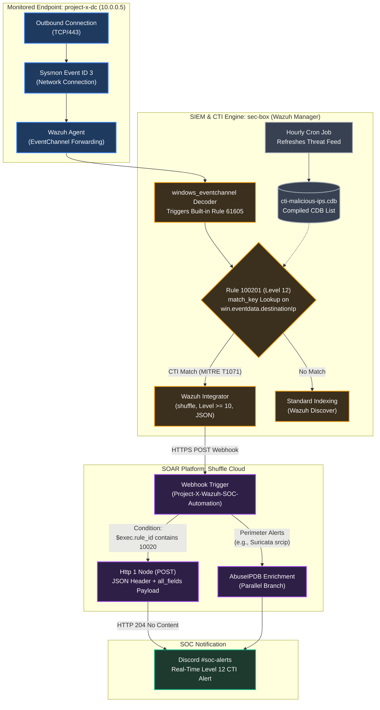

# Project X: Real-Time CTI Detection & Automated SOAR Alerting Pipeline


## Table of Contents

- [Overview](#overview)
- [Environment & Architecture](#environment--architecture)
- [Pipeline Architecture Diagram](#pipeline-architecture-diagram)
- [End-to-End Data Flow](#end-to-end-data-flow)
- [Phase 1: Threat Intelligence Feed & Detection Engineering (`sec-box`)](#phase-1-threat-intelligence-feed--detection-engineering-sec-box)
- [Phase 2: SOAR Workflow Architecture (Shuffle Cloud)](#phase-2-soar-workflow-architecture-shuffle-cloud)
- [Phase 3: Validation & Canary Testing](#phase-3-validation--canary-testing)
- [Engineering Challenges & Resolutions](#engineering-challenges--resolutions)
- [Proof of Execution](#proof-of-execution)

---

## Overview

This project implements an end-to-end **Cyber Threat Intelligence (CTI)** detection and **Security Orchestration, Automation, and Response (SOAR)** pipeline inside the **Project X** enterprise homelab. Rather than relying on manual log review or static indicators, the pipeline continuously correlates live Windows endpoint telemetry against an automated threat intelligence feed in **Wazuh SIEM**, maps matches to **MITRE ATT&CK**, and routes high-severity alerts through **Shuffle Cloud** directly to a SOC **Discord** channel in real time.

---

## Environment & Architecture

| Component | Host / Platform | Role in Pipeline |
| :--- | :--- | :--- |
| **Monitored Endpoint** | `project-x-dc` (`10.0.0.5` / `WIN-06QSBAFSSS6.corp.project-x-dc.com`) | Active Directory Domain Controller running Sysmon and the Wazuh Agent, shipping `Microsoft-Windows-Sysmon/Operational` logs via `EventChannel`. |
| **SIEM Manager** | `sec-box` (Ubuntu 22.04 LTS / Wazuh Manager) | Ingests endpoint telemetry, maintains the compiled `cti-malicious-ips.cdb` threat feed via hourly cron job, evaluates custom Level 12 rules, and dispatches JSON webhooks. |
| **SOAR Platform** | Shuffle Cloud (`Project-X-Wazuh-SOC-Automation`) | Receives Wazuh webhooks, branches alerts based on rule ID to bypass incompatible enrichment nodes, and formats clean Discord payloads. |
| **SOC Alerting** | Discord (`#soc-alerts`) | Receives real-time, structured Level 12 CTI alerts with rule ID, severity, affected host, and detection details. |

---

## Pipeline Architecture Diagram



---

## End-to-End Data Flow

1. **Telemetry Generation:** A process on `project-x-dc` initiates an outbound TCP/443 network connection, generating **Sysmon Event ID 3** (`Network connection detected`).
2. **Log Ingestion:** The Wazuh Agent forwards the Windows EventChannel log to `sec-box`, where Wazuh's `windows_eventchannel` decoder parses `win.eventdata.destinationIp` and evaluates built-in Sysmon rule **`61605`**.
3. **CTI Correlation:** Custom **Rule `100201`** (Level 12) checks `win.eventdata.destinationIp` against the compiled `etc/lists/cti-malicious-ips` CDB list.
4. **Webhook Dispatch:** Because the alert exceeds the `<level>10</level>` integration threshold in `ossec.conf`, `sec-box` dispatches the JSON alert payload to Shuffle Cloud.
5. **SOAR Routing & Notification:** Shuffle Cloud evaluates the branch condition (`$exec.rule_id contains 10020`), routes the alert directly to the Discord HTTP POST node (bypassing AbuseIPDB), and posts the alert to `#soc-alerts`.

---

## Phase 1: Threat Intelligence Feed & Detection Engineering (`sec-box`)

### 1. Automated CDB Threat List

Indicators of Compromise (IoCs) are stored in `/var/ossec/etc/lists/cti-malicious-ips` using Wazuh's `key:value` CDB format and refreshed hourly via cron. Whenever Wazuh restarts or reloads, it compiles the plaintext list into `/var/ossec/etc/lists/cti-malicious-ips.cdb` for low-latency lookups.

```text
<malicious_ip>:<threat_feed_source>
```

### 2. Custom Detection Rules (`/var/ossec/etc/rules/local_rules.xml`)

Custom CTI rules are grouped under `cti` and mapped to **MITRE ATT&CK**:

- **Rule `100200` (Level 12):** Matches File Integrity Monitoring (FIM) file hashes against known malicious hashes.
- **Rule `100201` (Level 12):** Chains directly off Wazuh's built-in Sysmon Event ID 3 rule (`61605`) and performs an exact key lookup (`lookup="match_key"`) against `cti-malicious-ips`, mapping detections to **MITRE ATT&CK `T1071` (Application Layer Protocol)**.

```xml
<rule id="100201" level="12">
  <if_sid>61605</if_sid>
  <list field="win.eventdata.destinationIp" lookup="match_key">etc/lists/cti-malicious-ips</list>
  <description>Real-Time CTI Match: Endpoint $(win.system.computer) attempted outbound connection to known C2 IP $(win.eventdata.destinationIp).</description>
  <mitre>
    <id>T1071</id>
  </mitre>
</rule>
```

### 3. Wazuh-to-Shuffle Integration (`/var/ossec/etc/ossec.conf`)

The native `shuffle` integration forwards all high-severity alerts (Level 10+, covering both Suricata perimeter blocks and Level 12 CTI matches) in JSON format:

```xml
<integration>
  <name>shuffle</name>
  <hook_url>[https://shuffler.io/api/v1/hooks/webhook](https://shuffler.io/api/v1/hooks/webhook)_<YOUR_WEBHOOK_ID></hook_url>
  <level>10</level>
  <alert_format>json</alert_format>
</integration>
```

---

## Phase 2: SOAR Workflow Architecture (Shuffle Cloud)

### Parallel Branching Design

The existing perimeter workflow routed alerts through **Webhook ➔ AbuseIPDB (`$exec.data.srcip`) ➔ Discord**. Because endpoint CTI alerts (`100200` and `100201`) do not populate a top-level `data.srcip` field, they failed at the AbuseIPDB node and never reached Discord.

To resolve this without disrupting perimeter enrichment, a **parallel branch** was connected directly from the **Webhook** trigger to a dedicated **HTTP POST** node (`Http 1`):

- **Branch Condition (`Webhook` ➔ `Http 1`):**
  - **Source:** `$exec.rule_id`
  - **Operator:** `contains`
  - **Destination:** `10020` *(matches both `100200` and `100201`)*

### Discord Webhook Node (`Http 1`)

- **Action:** `POST`
- **Headers (JSON object format):**

```json
{
  "Content-Type": "application/json"
}
```

- **Body (Single-line JSON mapped to Wazuh's live Shuffle schema):**

```json
{"content": "REAL-TIME CTI ALERT (Level $exec.all_fields.rule.level) | Rule ID: $exec.rule_id | Agent: $exec.all_fields.agent.name | Details: $exec.title"}
```

---

## Phase 3: Validation & Canary Testing

To validate the entire detection-to-response chain without introducing live malware into the lab:

1. **Canary Injection:** Temporarily appended `1.1.1.1:CTI_Canary_Test_C2` to `/var/ossec/etc/lists/cti-malicious-ips` and restarted `wazuh-manager` to compile the `.cdb` file.
2. **Traffic Simulation:** Executed the following from `project-x-dc` to generate an outbound TCP/443 Sysmon Event ID 3 log:
   ```powershell
   curl.exe -I [https://1.1.1.1](https://1.1.1.1) --max-time 5
   ```
3. **Verification:**
   - Confirmed `Rule: 100201 (level 12)` fired in `/var/ossec/logs/alerts/alerts.log` and indexed in **Wazuh Discover** (`rule.groups:cti`).
   - Verified clean webhook dispatch in `/var/ossec/logs/integrations.log`.
   - Verified `status: 204` in Shuffle Cloud Execution History and live alert delivery in Discord `#soc-alerts`.
4. **Production Cleanup:** Removed `1.1.1.1` from `cti-malicious-ips`, disabled `logall_json`, truncated `/var/ossec/logs/archives/archives.json`, and validated configuration syntax with `wazuh-analysisd -t`.

---

## Engineering Challenges & Resolutions

| Challenge Observed | Root Cause | Resolution |
| :--- | :--- | :--- |
| **Rule `100201` did not fire despite Sysmon Event ID 3 arriving in `archives.json`** | `lookup="address_match_key"` failed to match the exact string key in `win.eventdata.destinationIp`, and testing via `powershell.exe` risked interception by built-in Sysmon child rules. | Switched Rule `100201` to `<if_sid>61605</if_sid>` with `lookup="match_key"` and validated using `curl.exe` over TCP/443. |
| **Live alerts logged in `integrations.log` but never reached Shuffle Cloud** | A line break and trailing spaces before `</hook_url>` in `ossec.conf` appended newline characters to the outbound webhook URL. | Consolidated `<hook_url>...</hook_url>` onto a single line and restarted `wazuh-manager`. |
| **Discord rejected Shuffle HTTP POST requests with `400 Bad Request`** | Shuffle's HTTP app ignored plain-text `Content-Type: application/json` headers, causing Discord to reject the payload (`_misc` header error). | Reformatted the **Headers** field as a JSON object (`{"Content-Type": "application/json"}`) and used a single-line JSON body. |
| **Live Discord alerts arrived with blank fields** | Manual Shuffle test runs used a flat JSON schema (`$exec.rule.id`), whereas Wazuh's live `shuffle` integration puts `rule_id` and `title` at the top level and nests `rule` and `agent` under `all_fields`. \vert{} Updated the condition to `$exec.rule_id contains 10020` and mapped the body to `$exec.all_fields.rule.level`, `$exec.rule_id`, `$exec.all_fields.agent.name`, and `$exec.title`. |

---

## Proof of Execution

<!-- Replace the paths below with your uploaded screenshots inside an /assets folder -->

- **Wazuh Discover (`rule.groups:cti` — Rule `100201` / MITRE `T1071`):**
  ``
- **Shuffle Cloud Parallel Workflow Canvas:**
  ``
- **Shuffle Execution History (`status: 204`):**
  ``
- **Discord `#soc-alerts` Live Notification:**
  ``
